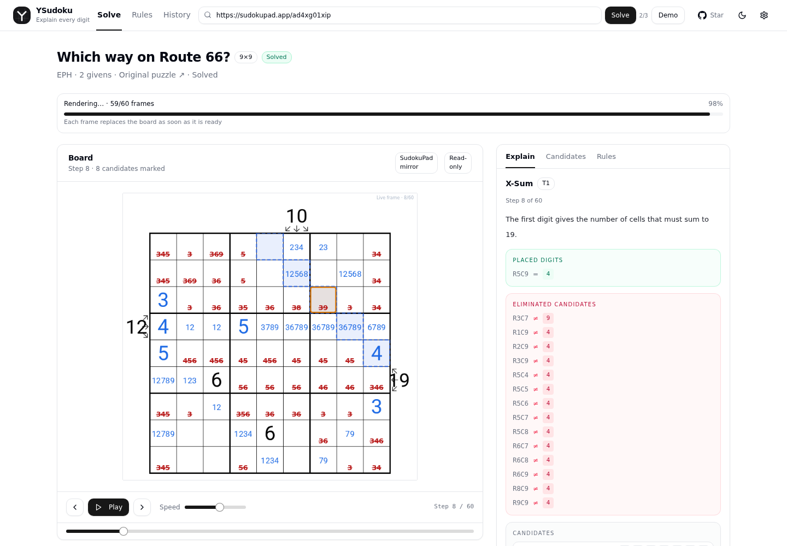
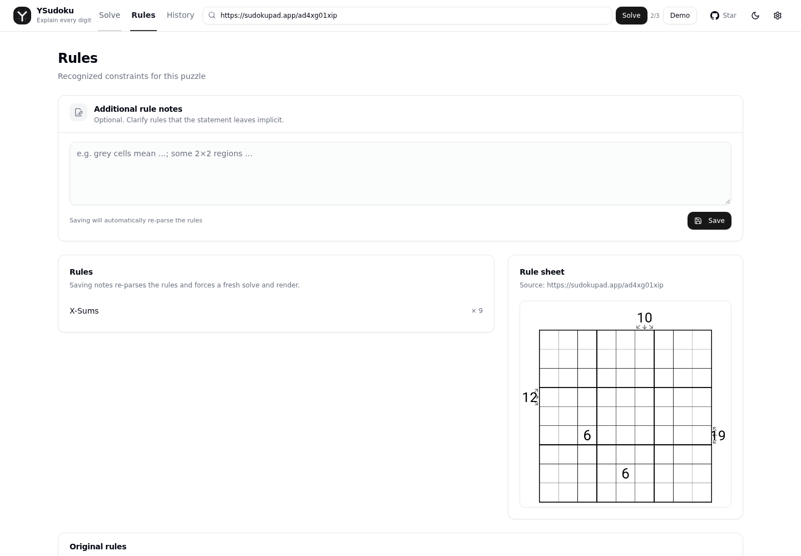

# YSudoku

English · [中文](README.zh-CN.md)

[](https://github.com/CodeInDreams/YSudoku/actions/workflows/ci.yml)
[](LICENSE)

YSudoku turns a SudokuPad variant into a playable, step-by-step solve. Each step shows the rule, the cells involved, and the changes to their candidates. The interface and explanations are available in English and Chinese.

Try YSudoku for free on the [author’s public server](https://ysudoku.660889.xyz/).

## Quick start

You need Git, Python 3.10+, and Node.js 20+ with npm. Install dependencies and build the web app once. If you already have the repository, run the last two lines from its root.

```bash
git clone https://github.com/CodeInDreams/YSudoku.git
cd YSudoku
npm --prefix web ci && npm --prefix web run build
npm --prefix tools ci && (cd tools && npx playwright install chromium)
```

Choose either startup command, then open [http://127.0.0.1:8765/](http://127.0.0.1:8765/) and click **Demo**.

### Local parsing

No API key is needed. If this terminal already has an API key configured, turn off LLM parsing in the web settings.

```bash
python3 -m ysudoku --web
```

### With an LLM

Replace `YOUR_DEEPSEEK_API_KEY` with your DeepSeek API key.

```bash
SUDOKU_LLM_API_KEY='YOUR_DEEPSEEK_API_KEY' python3 -m ysudoku --web
```



## Use YSudoku

1. Paste a SudokuPad link or puzzle ID into the **Solve** page. You can also open a Logic Masters puzzle that links to SudokuPad or click **Demo**.
2. The original board appears first, followed by the rule analysis and solve. Use playback, the slider, or the step list to explore the proof. Step 0 shows the original board.
3. The **Rules** page shows the original text and the recognized constraints. Add a clarification and regenerate if a rule needs correction.
4. Use **History** to reopen a puzzle from the shared cache. When the explanation language or solver version changes, you can keep the cached explanation or regenerate it.



## Rules and reasoning

| Family | Examples |
| --- | --- |
| Grid | Standard houses, diagonals, anti-knight, anti-king, non-consecutive |
| Cages, dots and arrows | Killer sums, product constraints, sum arrows, Kropki, XV, quadruples, parity |
| Lines | Thermometers, Renban, German and Dutch whispers, palindromes, between lines, clones, region-sum lines |
| Outside clues | Sandwich, skyscraper, Little Killer, directed X-Sums, Full Rank |
| Combined rules | Rule alternatives on one region, rule assignments with quotas across several regions, and propagation of candidate or occupancy information through overlapping scopes |

YSudoku decodes SudokuPad data into an inventory of shapes and cells. Local recognition and an optional language model map the inventory and rules text to typed constraints. The solver uses candidate propagation, support patterns, rule simplification, and refutation with a replayable proof. A Playwright worker generates read-only frames from SudokuPad in an isolated browser context.

Complex combinations can still stall. Chaos Construction can infer connections, borders and some region assignments, and full construction remains an active area of development. See the [solver and architecture guide in Chinese](docs/solver-guide.zh-CN.md) and the [rule DSL](docs/rule-dsl.md).

## Command line

The CLI also accepts local JSON and can emit a machine-readable proof.

```bash
python3 -m ysudoku --no-llm --json fixtures/demo-killer.json
```

Optional OpenAI-compatible rule parsing uses `SUDOKU_LLM_API_KEY`, `SUDOKU_LLM_BASE_URL` and `SUDOKU_LLM_MODEL`. See the [deployment guide in Chinese](docs/deployment.zh-CN.md) for concurrency, quotas, logs, proxy settings, and running under a dedicated account.

### Optional command-line tools

Use `--audit` to independently check deductions on suitable puzzles. Use `--browser` to enter a completed solve into the original SudokuPad page. The browser option takes a SudokuPad link and uses the Playwright installation above.

```bash
python3 -m ysudoku --audit --json fixtures/demo-killer.json
python3 -m ysudoku --browser https://sudokupad.app/6uhr6irwvd
```

## Develop

```bash
python3 -m unittest discover -s tests
node tests/native_annotations.mjs
npm --prefix web run build
```

## Special thanks

Thanks to the puzzle community at [Logic Masters Deutschland e.V. (LMD)](https://logic-masters.de/Verein/index.php), and to Sven Neumann for [Sven’s SudokuPad](https://sudokupad.app/), the web app used by Cracking The Cryptic.

[Contributing](CONTRIBUTING.md) · [MIT License](LICENSE)
