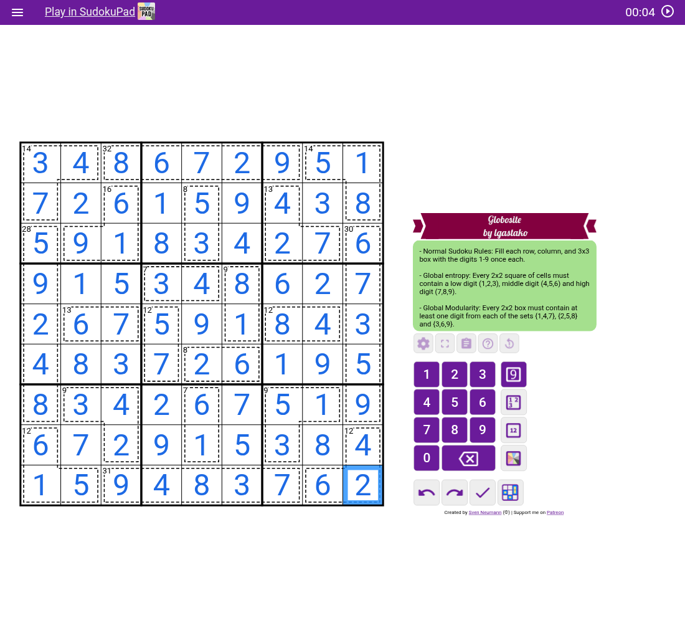

# YSudoku

中文 | [English](README.md)

**每一个数字，都有理由。**

[](https://github.com/CodeInDreams/ysudoku/actions/workflows/ci.yml)
[](LICENSE)

> 读音：**WHY-soo-doh-koo**（/ˌwaɪ suːˈdoʊkuː/），即 “why sudoku”。
> 中文可读作 **Y 数独**（“歪·数独”）。

YSudoku 把 [SudokuPad](https://sudokupad.app) 上的变形数独链接，变成**一步一步、可播放、可交互的推理动画**，而不是一个黑箱答案。

- 不是穷举：每一步都说明「根据什么规则、排除了什么、为什么」
- 可机械校验：可选穷举反证，对每一步结论做独立检查
- 可交互：网页里逐步播放高亮、描边、候选数划除、填数动画

## 快速开始

核心零第三方依赖，Python 3.10+：

```bash
git clone git@github.com:CodeInDreams/ysudoku.git
cd ysudoku
python3 -m ysudoku --web
# 打开 http://127.0.0.1:8765/
```

网页里点「示例」会加载真实题 **Globosite**（lgastako，229 步，约 2 秒），并给出 SudokuPad 原题链接。
输入框支持 SudokuPad 链接、**Logic Masters 题目页**（自动提取其中的 SudokuPad 链接）、裸 id、本地 JSON。

命令行看文字推理：

```bash
python3 -m ysudoku 7v57yvn5vf
python3 -m ysudoku --no-chains 7v57yvn5vf          # 关闭反证（默认开启，步骤标注 T4）
python3 -m ysudoku --audit --json https://sudokupad.app/eynwusqy5l > out.json
```

安装为命令（可选）：

```bash
pip install -e .
ysudoku --web
```

### 在真实 SudokuPad 里自动填入（可选）

如果想让程序直接操作 SudokuPad 页面（点格子、输入数字），可以用 Playwright 桥接：

```bash
cd tools
npm install
npx playwright install chromium
cd ..
python3 -m ysudoku --browser https://sudokupad.app/6uhr6irwvd
```

会打开一个真实浏览器，按 `Start Puzzle`，然后把解逐格敲进去：



这是本地自动化工具，不参与 Web UI；它只“写入”页面，不读取 SudokuPad 的内部状态。

## 它怎么工作

```
链接 → api/puzzle → scl 压缩串 → 自定义 LZW + zipper 解码
     → 网格 / 笼 / 线 / 圆 / 点 / 箭头
     → 元素清单 + 官方 rules 文本
     → LLM 编译成 JSON 约束（用题面答案逐条校验，失败自动回传修正）
     → 约束传播 + 人类技巧 → 每一步：中文解释 + 动画脚本
```

SudokuPad 的 JSON 只保存“画了什么”，真正的规则在 `metadata.rules` 里。例如 kropki 黑点只是一块黑色圆形，“三分圆”只是一个粗灰圆——所以必须有一层“图形 → 语义”的编译。YSudoku 用 LLM 做这层编译，并用题目自带答案做闭环校验；没有配置 key 时退回颜色/关键词启发式。

### LLM 配置（可选）

默认走 DeepSeek 的 `deepseek-flash`，也可以指向任何 OpenAI 兼容服务（OpenAI / Ollama / vLLM / OneAPI）：

```bash
export SUDOKU_LLM_API_KEY=sk-...
export SUDOKU_LLM_BASE_URL=https://api.deepseek.com   # 或 https://api.openai.com/v1
export SUDOKU_LLM_MODEL=deepseek-flash
```

本地 Ollama 示例（无需付费 key）：

```bash
ollama run qwen2.5:7b
export SUDOKU_LLM_BASE_URL=http://localhost:11434/v1
export SUDOKU_LLM_API_KEY=local
export SUDOKU_LLM_MODEL=qwen2.5:7b
```

没有 key 时网页会把「LLM 规则」置灰，并显示“未配置 key · 本地启发式”。

### 规则图（视觉）

规则编译器会把一张**规则图**一起发给模型：棋盘坐标、每个图形元素的编号、盘外线索，以及
“编号 → 元素 id / 格子 / 属性”的文字图例。`deepseek-flash` 支持 PNG data URI，能据此判断
箭头方向、线索在哪一侧、哪个圆包住哪四格等纯文本容易丢失的空间关系；模型不支持图片时自动
退回文本规则表。网页里也能在「规则图（视觉）」面板直接查看。

### 全局盘外线索（可选）

有些题把**全局线索**放在盘外：Full Rank（一行/列在 36 个方向数里的排名）、X-Sums，
甚至“每个线索数字出现两次，一次 Full Rank、一次 X-Sums”。逐格传播处理不了，需要可选的 CP-SAT：

```bash
pip install "ysudoku[global-clues]"     # 或直接 pip install ortools
```

YSudoku 会把棋盘、36 个方向数、排名比较、前缀和、未知类型配对一起编码进 CP-SAT。
Flinty & palpot 的 *Double Take*（`439w9opvs4`）约 **5 秒**解出，并还原 12 条线索的类型分配，
结果与官方答案一致。没有 OR-Tools 时，这类题会明确报 unsupported 并提示安装，不会假装卡住。

### 规则缓存

编译结果按「题目 id + 规则文本 + 元素清单」的指纹缓存，换机器/改题都会自动失效：

- `.cache/rules/<id>.json`：本地缓存，LLM 编译成功后自动写入（已 gitignore）
- `rules/<id>.json`：共享缓存，用 `--save-rules` 写入，可随仓库提交、供他人直接复用

```bash
python3 -m ysudoku --save-rules <sudokupad-url>   # 写入共享规则
python3 -m ysudoku --no-cache <sudokupad-url>     # 跳过缓存
```

健康检查：`GET /api/health` 返回 LLM 是否可用、模型名、缓存条目数。

### 卡住后的规则修复

如果规则 spec 编译成功、但求解器半路卡住，YSudoku 会把**诊断信息**（已尝试技巧、未使用的元素、警告）
回传给 LLM，让它重读规则文本并输出一份修正后的完整 spec；新 spec 仍须通过与官方答案的校验才会被采用。
这一步只做“重新理解规则”，不会把答案喂给模型，也不会凭空增加约束。

反证默认开启，也可以取消勾选「反证求解」；这类步骤标注为 T4，
并明确提示不是纯直接推理。

关于“让 LLM 自创规则”的边界、类型化 DSL 与可信性护栏，见
[docs/rule-dsl.md](docs/rule-dsl.md)。

## 支持的约束

| 类别 | 约束 |
|---|---|
| 求和 | 杀手笼（组合 + 逐格匹配）、小杀手、45 法则（innie/outie） |
| 线 | 温度计、箭头（实验性）、回文、Renban、德式/荷式 Whisper、之间线、连续线 |
| 点/提示 | 黑白点（连续 / 1:2）、XV、四格提示（圆圈内数字，支持 `?`） |
| 全局 | 对角线、反骑士、反国王、锯齿区域、6×6、模块 2×2、熵 2×2 |
| 混沌 | 笼、四格提示、**区域计数**（三分圆/不平衡圆），精确计数 GAC + 连通可达性 |
| 其他 | 奇偶、克隆、三明治、摩天楼、区域和线 |
| 盘外线索 | 三明治/摩天楼/X-Sums；Full Rank 与未知类型配对用可选 CP-SAT |
| L2 自定义 | 类型化谓词（sum/count/ordered/all_different/…），LLM 可组合，标注「推测」|

技巧分层：T1 约束局部 → T2 唯一候选/隐性唯一/区块排除/数组/45 法则 →
T3 X-Wing / XY-Wing / W-Wing / **染色法**（单数字强链、A/B 双色、同色互见与双色夹击）
/ **3D Medusa**（格+数字候选、强弱链、同色冲突/双色夹击/同格双色）
/ **X-Chain**（单数字强弱链交替，两端夹击）/ **ALS-XZ**（两个几乎锁定集、受限共同候选）
→ T4 反证（默认开启，`--no-chains` 或取消勾选「反证求解」）。
每一步都带结构化理由与动画脚本；T4 步骤会明确标注“这是反证，不是直接推理”。

## 动画与交互

- 左侧棋盘：候选数、区域边界、约束描边（笼框、箭头线、鱼形连线）
- 右侧解释卡：结论、规则前提、逐步影响；可展开规则理解与步骤列表
- 默认浅色（与 SudokuPad 一致），可切深色并记住选择
- **本地历史记录**：每次求解写入 `.cache/history.json`（标题、时间、状态、步数）；
  侧栏「历史记录」可重新打开或清空，数据不出本机
- 手机端响应式布局：头部纵向排列、棋盘占满宽度、触控友好的按钮
- 控制：上一步 / 下一步 / 播放暂停 / 速度 / 进度条 / 键盘方向键
- **SudokuPad 原题 + 标注**：左侧嵌入官方页面，高亮/连线直接叠在原题上；
  可点「校准」用三根滑杆对齐并记住；标注层不拦截点击，可在原题里正常落子。
  跨域限制：不会读取 SudokuPad 的内部状态，也不会把落子同步回本工具
- 每步的 `visual` 字段是一份视觉脚本：`focus`、`groups`、`links`、`chips`，前端据此播放高亮、描线、划除与弹出

## 结构

```
ysudoku/
  decode.py      SudokuPad LZW + zipper 解码（已与官方实现逐字段比对）
  model.py       网格 / 区域 / 笼 / 线 / 圆 / 点 / 箭头
  sudokupad.py   链接解析、API 拉取、本地缓存
  rules.py       元素清单、LLM/启发式规则 spec、约束编译
  rulecache.py   规则缓存（本地 + 共享）
  llm.py         OpenAI 兼容客户端 + 规则编译 prompt
  predicate.py   L2 自定义规则的类型化谓词
  state.py       候选域、事件日志、单位
  constraints.py 各类约束的传播 + 检查
  techniques.py  人类技巧（45 法则、翅膀、染色、Medusa、链、ALS）
  chaos.py       混沌构造搜索（区域 + 数字）
  solve.py       调度器、审计、答案校验
  search.py      仅作裁判：唯一性、逐步反证、卡住提示
  narrate.py     中文解释 + 动画脚本生成
  server.py      标准库 HTTP 服务
  static/        单页前端（原生 JS/CSS/SVG）
tests/           解码、引擎、纯数独、LLM mock/修复回归
fixtures/        示例题与原始数据
rules/           共享规则 spec（可提交）
docs/            规则 DSL 与可信性设计
```

## 已知限制

- **混沌构造**：首个版本是搜索求解，不是逐步人类推理；区域计数规则可在搜索中剪枝，
  但 *Tringle and Cross*（三分圆+不平衡圆）在约 90 万结点仍会超时；视野/边界遮挡规则暂不支持
- **Full Rank / 混合盘外线索**：需要可选的 OR-Tools；未安装时会明确报 unsupported（Double Take 是回归用例）
- **雾战 / 带草稿表的题**：暂不支持（网格数据本身不完整）
- 作者自定义画法依赖 LLM 编译；无 key 时启发式可能识别错
- 高难题仍可能卡住：求解器如实报告「卡住」而不是偷偷穷举；反证只能兜底一部分
- 箭头语义仍在验证，标为实验性
- 规则修复依赖 LLM；没有 key 时只有启发式 + 本地求解

## 测试

```bash
python3 -m unittest discover -s tests -v
```

CI 在每次 push 时跑同一套测试。

## 路线图

- **P2（基本完成）**：XY-Wing / W-Wing / 反证、三明治、摩天楼、区域和线、
  克隆、奇偶、6×6 已落地；剩 f-puzzles 导入
- **P2.5（已完成第一版）**：类型化规则 DSL —— LLM 用受控表达式组合出新约束（不写代码），
  所有“自创规则”标注来源、带「推测」徽章、可用官方答案做否证；详见 [docs/rule-dsl.md](docs/rule-dsl.md)
- **P3（部分完成）**：混沌搜索与区域计数传播已落地；下一步是可解释的区域归属推理与更强的区域 GAC

## 贡献

欢迎 PR：新增约束/技巧时请附一道可公开访问的 SudokuPad 链接作为回归用例，并确保
`python3 -m unittest discover -s tests` 通过。共享规则放在 `rules/`，格式见
[rules/README.md](rules/README.md)。

## License

MIT，见 [LICENSE](LICENSE)。
