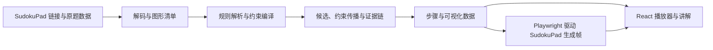

# 求解器与技术架构

## 从原题到讲解

图形清单记录线、箭头、笼、圆点、文字的位置和覆盖格。规则文本赋予图形语义。本地解析器识别已知规则，配置 LLM 后也可结合图形清单和原题截图编译规则。编译结果转换为受限的谓词或内置约束。题面附带答案时，可用于检查规则是否与原答案一致。

## 通用求解能力

- **候选传播。** 用位集存储候选。填数和排除会触发相关行列宫与变形规则。每条操作携带原因和作用范围，讲解可据此定位盘面。
- **组合支持与区域交集。** 在预算内枚举一个规则范围的可行组合，投影到重叠格或同一数独单位，再合并两个范围的证据。所有可行组合共有的数字、占位和位置限制，可以继续传给其他规则。组合预算耗尽时保留未知状态。
- **规则选择与分配。** 区域可以有多个候选规则，若干区域也可以共享规则使用次数。求解器排除不可行的分配，并把剩余分配共同支持的结论传回盘面。Double Take 的 X-Sum 与 Full Rank 是此类问题的例子。
- **约束简化。** 当现有候选或已知格足以证明一个更简单的约束在相关范围内等价时，求解器可以使用简化形式。较小的范围更容易与其他规则组合。比如 3 格和为 9 且互异的笼，在一格为 6 时只剩另外两格分配 1 和 2。
- **反证与证据回放。** 直接推理停滞时，测试一个候选或规则分支，应用有范围的传播，并保存导致冲突的支持链。若得出矛盾，回退临时状态并提交可证明的排除。播放器区分假设中的变化与主盘面上的结论。
- **规则交互。** 灰线和 3×3 宫的共享格、不同笼里的重复组合、盘外读数的头部和尾部，都会形成可传递的限制。已有规则的作用范围可以是不相邻的格组。

典型代码入口见 [约束编译](../ysudoku/rules.py)、[组合交集](../ysudoku/intersections.py)、[规则选择](../ysudoku/rule_choice.py)、[约束简化](../ysudoku/simplify.py)、[求解器](../ysudoku/solve.py) 和 [讲解](../ysudoku/narrate.py)。

## 运行架构

| 层 | 职责 |
| --- | --- |
| Python HTTP 服务 | 接收谜题、发布任务进度、协调共享规则、步骤和截图缓存 |
| Python 规则与推理引擎 | 解码、约束编译、支持传播、生成中英文证据及叠层数据 |
| Node.js 与 Playwright | 用隔离的 SudokuPad 会话重播步骤，生成第 0 步到最后一步的只读截图 |
| React、Vite、Tailwind | 搜索、播放、讲解、候选、规则和历史 |
| 文件缓存与 SQLite | 保存分层结果及每日求解与令牌用量 |

## 正在攻克的难题

**混沌构造（Chaos Construction）**的区域边界也是未知量。现有求解器能维护已连通和已隔离的格组，利用正交连通、固定区域大小和同区数字互异来扩张区域或排除连接。它也能根据圈域提示缩小可能的边界，并在回放里表示已知区域和候选连接。

困难在于局部可行的边界未必能共同铺满全盘。多个区域会争用同一条通路或同一批格子。稳定地识别这种全局争用、把它压缩为短证据，以及在证据成立后继续传给数字规则，仍是主要工作。Tringle and Cross 可用于观察当前构造能力和卡点。

通用支持分析也有现实边界。高扇出的多区域规则分配和多条长线的交叠会迅速放大组合数量。引擎优先使用小作用域与结构化子模式，超过预算时回报当前推理进度。
